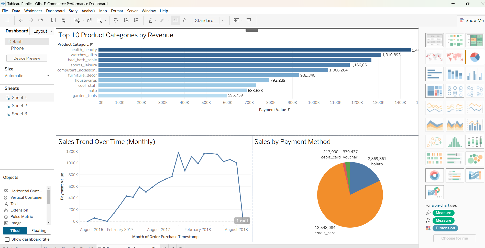

# Olist E-Commerce Data Platform and Analytics

An end-to-end data engineering and business intelligence project analyzing the Olist Brazilian E-Commerce dataset using Python, SQL, PostgreSQL, Apache Airflow, Docker, and Tableau.

---

## Project Overview

This project follows a complete data engineering and analytics workflow: processing raw e-commerce transaction data, storing it in a PostgreSQL database, orchestrating pipelines with Apache Airflow, and presenting key performance indicators in an interactive Tableau dashboard.

### Business questions answered:
* What are the overall revenue and order trends month by month?
* Which product categories drive the highest revenue?
* What are the preferred customer payment methods?

---

## Dataset

* **Source:** [Olist Brazilian E-Commerce Dataset on Kaggle](https://www.kaggle.com/datasets/olistbr/brazilian-ecommerce)
* **Volume:** Over 1 million raw transaction rows processed and cleaned.

---

## Tech Stack and Architecture

* **Data Processing & Cleaning:** Python, Pandas (Processed over 1M+ raw transaction rows)
* **Database & SQL:** PostgreSQL, Complex SQL queries for revenue and order aggregations
* **Orchestration & Containerization:** Apache Airflow, Docker
* **Data Visualization:** Tableau Public

---

## Process

1. **Data Cleaning & ETL:** Extracted and cleaned raw relational datasets (orders, items, customers, payments, products) using Python and Pandas, handling missing values and data types.
2. **Database & SQL Analysis:** Loaded the structured data into a PostgreSQL database and executed SQL queries to analyze revenue distribution, top product categories, and payment trends.
3. **Pipeline Orchestration:** Configured Apache Airflow DAGs running within Docker containers to automate and manage the data pipeline workflow.
4. **Tableau Dashboard:** Built an interactive Tableau dashboard featuring top product categories, monthly sales trends, and payment method breakdowns with cross-filtering capabilities.

---

## Key Findings

* **Revenue Drivers:** Health & beauty, watches & gifts, and bed bath table emerged as top-performing product categories by revenue.
* **Payment Preferences:** Credit card remains the dominant payment method among customers, followed by boleto and vouchers.
* **Order Analytics:** Successfully aggregated thousands of orders to track monthly sales growth and seasonal fluctuations.

---

## Interactive Tableau Dashboard

* **Live Dashboard:** [View on Tableau Public](https://public.tableau.com/views/OlistE-CommercePerformanceDashboard_17924261483450/E-CommercePerformanceDashboard?:language=en-GB&:sid=&:redirect=auth&:display_count=n&:origin=viz_share_link)

### Dashboard Preview


---

## Project Structure

```text
├── dags/                  # Apache Airflow DAGs for pipeline orchestration
├── data/                  # Cleaned datasets and storage configurations
├── scripts/               # Python ETL and data cleaning scripts
├── sql/                   # SQL queries for database schema and analysis
├── dashboard_preview.png  # Tableau dashboard screenshot preview
└── README.md              # Project documentation
